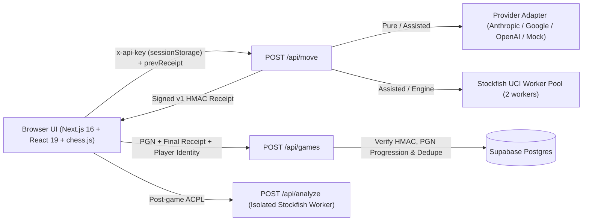

# Chess Arena (Human vs AI)

Play chess against **Anthropic Claude**, **Google Gemini**, **OpenAI GPT** (including reasoning models), or a **Stockfish** engine baseline directly in the browser using your own API key (BYOK). `chess.js` enforces strict move legality on both client and server, illegal model replies are caught and retried, a pooled Node Stockfish engine evaluates positions and post-game accuracy, and a chained HMAC-SHA256 receipt protocol protects the `3 / 1 / 0` ranked scoreboard.

---

## Visuals

### Arena Setup (Dark Mode, Handle, Avatars & BYOK)


### Active Match (Board, Eval Bar, Clocks, Opening & Move Log)


### Ranked Scoreboard & Model Comparison (`/models`)


### Match History (`/history`)


---

## Architecture



---

## Core Specifications

### Game Modes
- **Pure Model (`pure`):** The model chooses every move from the board state without Stockfish candidates. Attempt 1 omits the legal-move list to measure unassisted legality; Retry 1 and Retry 2 inject legal moves for recovery.
- **Assisted Model (`assisted`):** Server Stockfish computes the top 3 candidate moves and centipawn evaluations and passes them to the model. Assisted games are labeled separately in the UI and leaderboard.
- **Engine Baseline (`engine`):** Plays directly against Node Stockfish at a configurable skill level (`0`–`20`), with zero LLM calls.

### Illegal-Move Policies
- **Strict (`strict`):** Up to 2 retries (3 total attempts). If the model still fails to return a legal SAN move, it forfeits.
- **Friendly (`friendly`):** Up to 2 retries. If retries fail, the server plays the first legal move (`legalMovesSan[0]`) and flags the move as fallback-used.

### BYOK Key Privacy & Open Model Selection
- Users select any built-in preset or enter any custom model ID for **Anthropic**, **Google Gemini**, or **OpenAI**.
- OpenAI reasoning-family models (`o1`, `o3`, `o4`, `gpt-5`, etc.) automatically use `max_completion_tokens` with reasoning headroom and omit unsupported `temperature`.
- Public users supply their own provider API key (`x-api-key`) per request; keys are kept only in `sessionStorage` for the active browser tab (never persisted to `localStorage`, cookies, server logs, or Postgres).
- In `NODE_ENV=production`, non-mock LLM requests without `x-api-key` return HTTP `401`.
- Deterministic `mock-*` bots (`mock-legal`, `mock-illegal-once`, `mock-always-illegal`) run with zero API keys for local development and automated tests.

### Player Identity & Ranked Scoreboard Integrity (`3 / 1 / 0`)
- **Identity:** Players pick a handle (`2`–`24` characters) and one of 8 built-in chess avatars (`king`, `queen`, `rook`, `bishop`, `knight`, `pawn`, `crown`, `flame`). Handle ownership is first-come via a client-generated `playerToken` stored in `localStorage` and verified by SHA-256 hash on the server.
- **Scoring:** Win = `3` pts, Draw = `1` pt, Loss = `0` pts (ranked eligibility requires `pure` or `assisted` mode against a real LLM opponent).
- **Chained HMAC Receipts:** `/api/move` issues chained HMAC-SHA256 receipts (`v1.<payload>.<sig>`) tracking `gameSessionId`, `ply`, `pgn`, `modelId`, `mode`, cumulative `illegalAttempts`/`fallbackMoves`/`totalTokens`, `forfeitedBy`, and `verifiedFromStart`.
- **Anti-Tamper & Deduplication:** `POST /api/games` verifies the receipt chain (allowing `0` or `1` trailing human ply), rejects AI-resign spoofs (`resignedBy !== humanColor`), deranks (`is_ranked = false`) takeback/clock/draw-agreement/unverified games, and enforces unique partial indexes on `game_session_id` and `receipt_hash` (`409 Conflict` on replay).

### UI & Gameplay Features
- **Dark Mode Default:** Defaults to dark mode with a persistent header theme toggle across `/`, `/history`, `/models`, and `/games/[id]`.
- **Interactive Board & Themes:** Click/drag moves, legal-move highlights, promotion dialog, check/last-move highlights, and selectable board themes (`Classic`, `Slate`, `Walnut`).
- **Clocks, Draw Offers & Opening Detection:** Optional time controls (`Unlimited`, `5+0 Blitz`, `10+0 Rapid`, `15+10 Rapid`) with increment and timeout handling, draw offers, automatic ECO opening detection, and synthesized Web Audio sound effects with mute toggle.
- **Bilingual UI (EN / AR):** Full English (LTR) and Arabic (RTL) interface while keeping the chessboard strictly `dir="ltr"`.

---

## Tech Stack & API Surface

| Layer | Technology |
| :--- | :--- |
| Framework | Next.js `16.4.6` (App Router, Turbopack, Cache Components) + React `19.3` + TypeScript |
| Styling | Tailwind CSS v4 + `lucide-react` |
| Chess & Engine | `chess.js` + `react-chessboard` + pooled Node `stockfish` (`^19.0.1`) |
| LLM SDKs | `@anthropic-ai/sdk`, `@google/genai`, `openai` |
| Persistence | Supabase Postgres (server-only `SUPABASE_SERVICE_ROLE_KEY`) |
| Validation & Tests | Zod v4, Vitest, Playwright, ESLint (`--max-warnings=0`) |

| Endpoint | Purpose |
| :--- | :--- |
| `POST /api/move` | Validates board state, calls LLM/Stockfish, updates chained HMAC receipt, returns legal SAN + eval |
| `GET / POST /api/games` | Lists match history or verifies & persists a completed game (`is_ranked` + deduplication) |
| `GET /api/games/[id]` | Fetches a saved game and move-by-move replay log |
| `GET /api/models` | Returns model comparison stats and the `3/1/0` ranked player scoreboard |
| `POST /api/analyze` | Runs isolated batch Stockfish analysis (`ACPL` and accuracy %) on a PGN |
| `GET /api/health` | Reports production env validity, Stockfish pool health, and Supabase status |

---

## Local Setup

1. Install dependencies:
   ```bash
   npm install
   ```
2. Copy `.env.example` to `.env.local` and configure optional keys, Supabase credentials, and `ARENA_SIGNING_SECRET`:
   ```bash
   cp .env.example .env.local
   ```
3. Apply the Supabase migrations in order (`supabase/migrations/`) if using persistent history and `/models` leaderboard:
   - `0001_init.sql`
   - `0002_scoreboard_identity.sql`
   - `0003_scoreboard_integrity.sql`
4. Start the development server:
   ```bash
   npm run dev
   ```

---

## Docker Deployment

Build and run the multi-stage production container (`node:22-slim`, non-root user, `/api/health` healthcheck, bundled Stockfish preserved):

```bash
docker build -t chess-arena .
docker run -p 3000:3000 \
  -e NODE_ENV=production \
  -e ARENA_SIGNING_SECRET="$(openssl rand -hex 32)" \
  -e NEXT_PUBLIC_SUPABASE_URL="https://your-project.supabase.co" \
  -e NEXT_PUBLIC_SUPABASE_ANON_KEY="..." \
  -e SUPABASE_SERVICE_ROLE_KEY="..." \
  chess-arena
```

---

## Verification & Benchmark

```bash
npm run typecheck
npx eslint src --max-warnings=0
npm run test
npm run build
npm run test:e2e
npm run benchmark -- --dry-run
```

For a real CLI benchmark run against Stockfish (using server environment keys):

```bash
ANTHROPIC_API_KEY=... GEMINI_API_KEY=... OPENAI_API_KEY=... npm run benchmark -- --models=claude-haiku,gemini-flash,gpt-4o-mini --levels=1,5 --games=2
```

---

## Known Limitations

- **Hosting:** Server-side Node Stockfish requires a persistent Node.js runtime (container/VM) rather than stateless edge functions.
- **Rate Limiting:** The bounded sliding-window rate limiter (`MAX_BUCKETS = 10,000`, `20/min` on `/api/move` and `/api/games`, `5/min` on `/api/analyze`) is in-memory per Node instance.
- **Unauthenticated Persistence:** Anonymous games are saved and read through Next.js server routes using `SUPABASE_SERVICE_ROLE_KEY`; direct `anon` table access is denied by RLS.
